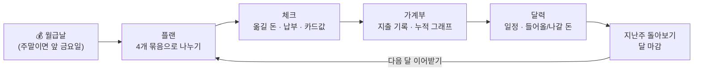
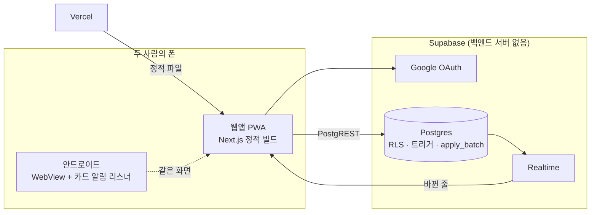
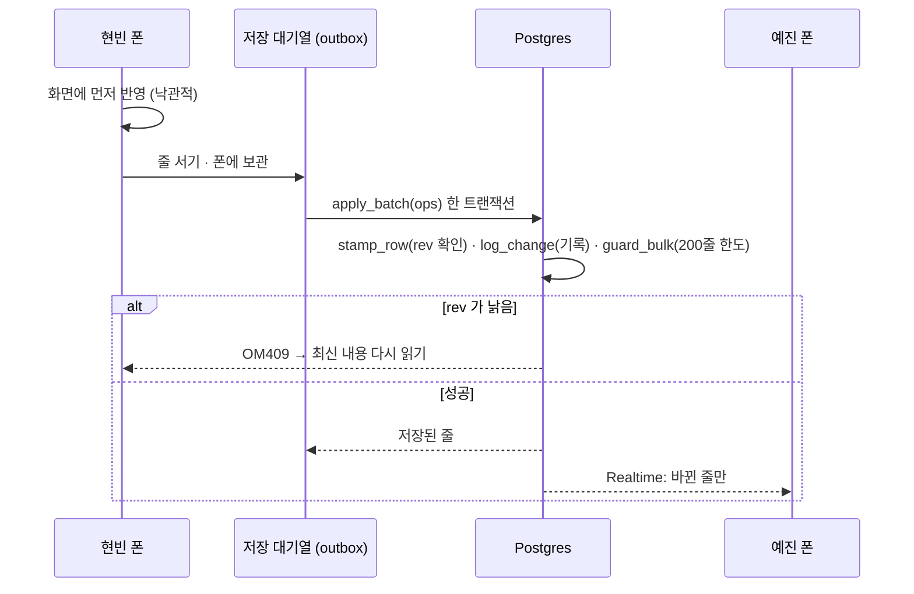
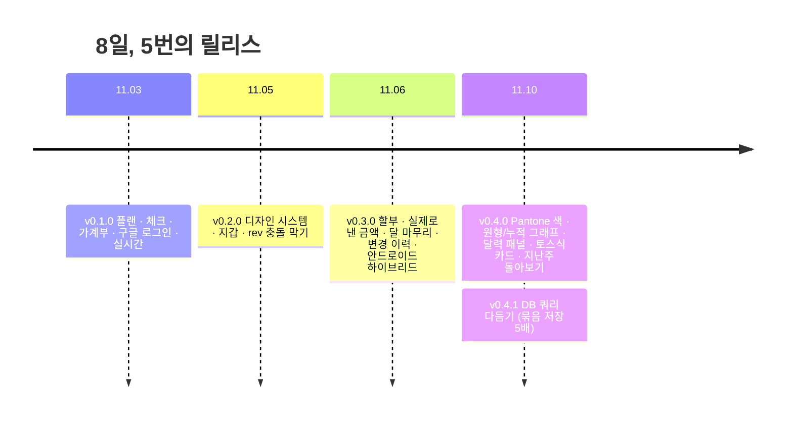

# 우리 집 가계부 · OUR MONEY

**부부 두 사람의 월급 배분 → 이체 체크 → 지출 기록 → 일정까지, 한 달을 한 앱으로**

    

> 저희 부부 두 사람만 쓰는 앱이라 코드만 공개해요. 저장소에 실제 데이터·연결 정보는 없고, 화면의 이름(현빈·예진)과 금액은 모두 가상이에요.

## 한눈에

| 기간 | 역할 | 사용자 | 커밋 · PR | 버전 · DB 이전 |
|:---:|:---:|:---:|:---:|:---:|
| 2026.11.03 – 11.10 | 기획 · 디자인 · 웹 · 안드로이드 · DB (1인) | 2명 | 162 · 68 | v0.4.1 · 13개 |

## 문제 → 해결

| 전에 (구글 시트) | 이제 (이 앱) |
|---|---|
| 폰에서 칸을 찾아 고치기 어려움 | 엄지 하나로 10초 안에 지출 기록 |
| "이번 달 누가 어디로 얼마 옮기지?"를 매달 계산 | 플랜에서 **이체 목록을 자동으로** 만들고 체크 |
| 한 사람이 고치면 다른 사람은 모름 | 두 폰에 **실시간** 반영, 동시에 고쳐도 충돌을 막음 |

## 화면

| 플랜 | 체크 | 가계부 | 달력 | 알림 |
|:---:|:---:|:---:|:---:|:---:|
|  |  |  |  |  |
| 조각을 누르면 튀어나오는 원형 그래프 | 월급날마다 옮길 돈 진행선 | 이번 달 vs 지난달 누적 지출 | 애플 캘린더식 날짜 패널 | 지난주 돌아보기 |

👉 **[예시 데이터로 직접 써 보기 (사용 안내)](docs/GUIDE.md)**

## 아키텍처

### 저장 한 번이 두 폰에 닿기까지

## 엔지니어링 포인트

| 문제 | 해결 | 결과 |
|---|---|---|
| 두 폰이 같은 줄을 동시에 고침 | 줄마다 `rev`, 트리거가 낡은 rev 를 `OM409` 로 거절 | 덮어쓰기 0, 충돌 시 자동 새로고침 |
| 지하철에서 저장이 끊김 | 대기열(outbox) + 지수 백오프·지터 재시도, id upsert 라 재전송 안전 | 저장이 사라지지 않음 |
| 달 시작 = 달 + 항목 수십 줄 | `apply_batch` 한 트랜잭션, 같은 칸 구성끼리 한 문장으로 (014) | 500줄 **114ms → 20ms** (약 5배) |
| PostgREST 는 1,000줄까지 | `(date, id)` keyset 페이지, OFFSET 없음 | 받는 도중 줄이 바뀌어도 빠짐·겹침 없음 |
| 이메일만으로 멤버가 되면 위험 | RLS 를 `auth.uid()` 에 묶고, 처음 로그인은 구글 계정만 연결 | 남이 만든 같은 이메일 계정 차단 |
| 웹·안드로이드 계산이 어긋날 위험 | 같은 규칙을 `calc.ts` · `Calc.kt` 로, 코어 테스트 41개 | 월급날 주말 당김까지 같은 결과 |
| 카드 알림을 지출로 | 알림 해석기 + 확실하지 않은 칸은 `review` 로 남기기 | 사람이 확인할 칸만 표시 |
| 실수로 대량 삭제 | 문장 단위 트리거 `guard_bulk` (200줄 초과 거절) | 조건 빠진 DELETE 사고 방지 |

## 디자인 시스템

- 색·글꼴·간격·움직임은 [`tokens.json`](docs/design-system/tokens.json) 하나에서 → `tokens.css` 생성, CI 가 어긋남을 막음
- 노랑은 흰 바탕과 대비가 1.35:1 → **넓은 채움에만**, 글자·선은 올리브(`accent-ink` 8.1:1)
- 컴포넌트 22개마다 규칙 + 움직이는 미리보기 → [`docs/design-system/`](docs/design-system/README.md)

## 버전

## 기술

| 영역 | 사용 |
|---|---|
| 웹 | Next.js 16 (App Router, 정적 export) · React 19 · vaul · lucide-react · Pretendard / Alan Sans |
| DB · 인증 · 실시간 | Supabase — Postgres · RLS · PL/pgSQL 트리거 · Google OAuth · Realtime |
| 모바일 | Kotlin 2.4 · Compose Multiplatform 1.12 · AGP 9.5 · supabase-kt · NotificationListenerService |
| 품질 | GitHub Actions (비밀값 3겹 · 웹 빌드 · 모바일 테스트 · PR 규칙 · 태그 릴리스) · Playwright 화면 검증 · PGlite 로 SQL 검증 |

## 더 보기

| 문서 | 내용 |
|---|---|
| [사용 안내](docs/GUIDE.md) | 예시 데이터로 모든 기능 따라 해 보기 |
| [설계](docs/ARCHITECTURE.md) | 계산 규칙 · 데이터 모델 · 보안 · 성능 · 저장소 구조 · 개발 규칙 |
| [직접 구축하기](docs/SETUP.md) | Supabase · 구글 로그인 · 배포 · 폰 설치 · 안드로이드 빌드 |
| [디자인 시스템](docs/design-system/README.md) · [변경 기록](CHANGELOG.md) | 화면 규칙 · 버전별 변경 |
