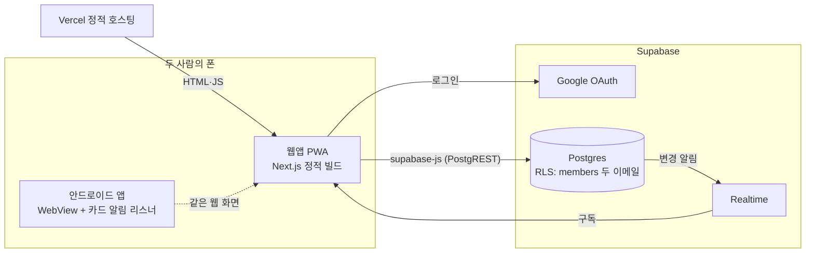
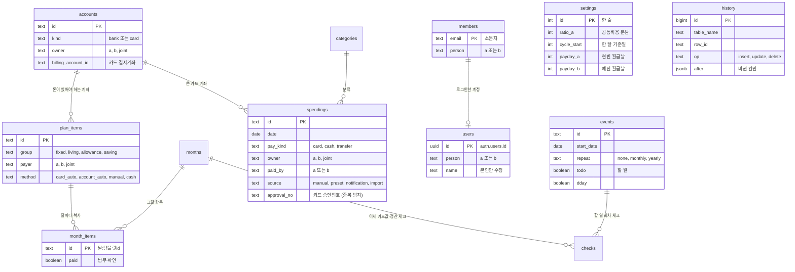

# 설계

[← README](../README.md) · [왜 이렇게 만들었나](DECISIONS.md) · [사용 안내](GUIDE.md) · [직접 구축하기](SETUP.md)

## 왜 만들었나

원래 구글 시트("OUR MONEY · 우리 집 부부 가계부")로 관리했는데, 폰에서 보고 고치기가 너무 힘들었어요. 저희 집은 이렇게 돈이 움직여요.

- 두 사람은 **각자 자기 통장으로 월급을 받고**, 그중 일부만 공동 통장으로 옮겨요. 월급날은 **서로 달라서**, 각자 자기 월급날에 자기 몫을 옮겨요. 금액은 거의 정해져 있어요.
- 고정비는 카드 자동결제, 계좌 자동이체, 직접 이체로 여러 통장에서 나가요.
- 매달 하는 일: 각자 월급날 → 플랜 확인 → 내 월급통장에서 이체 → 체크 → 고정비·저축이 나갔는지 확인 → 카드 결제일 전에 카드값 준비.

일반 가계부 앱은 지출만 기록해요. 이 앱은 **플랜에서 "이번 달 누가 어느 통장으로 얼마를 옮겨야 하는지"를 계산**해 주는 데 초점을 맞췄어요. 통장 잔액 추적은 일부러 넣지 않았어요.

## 계산 규칙과 동작

각 기능마다 무엇을 하는지, 어떻게 계산하는지, 코드가 어디 있는지 적었어요. 계산은 모두 `apps/web/src/lib/calc.ts` 에 있고, 모바일 `apps/mobile/core/.../calc/Calc.kt` 에 같은 규칙으로 옮겨져 있어요. 화면으로 따라 해 보려면 [사용 안내](GUIDE.md)를 보세요.

### 1. 플랜: 월급이 나뉘는 곳

| | |
|---|---|
| 하는 일 | 그달 수입을 **고정비 · 공동 생활비 · 용돈 · 저축·투자** 네 묶음에 배분해요. 항목마다 누구 돈인지(현빈/예진/공동), 나가는 방식(카드 자동결제/계좌 자동이체/직접 이체/현금), 돈이 있어야 하는 계좌, 날짜를 정해요. |
| 화면 | 수입이 네 묶음과 남음으로 어떻게 나뉘는지 수입 큰 숫자와 한 줄 쌓은 막대, 금액 목록으로 보여 줘요(두 사람·현빈·예진). 이름을 누르면 그 조각만 남고 항목이 펼쳐져요(`SplitBar`). 저축 항목에 목표 금액을 넣으면 진행률이 나와요. |
| 계산 | 공동 항목은 분담 비율로 나눠요. 비율은 **정한 비율**(예: 50:50)이나 **월급 비율** 중에서 골라요. A 몫은 반올림하고, B 는 나머지를 가져가서 합이 원래 금액과 꼭 맞아요 (`split`, `shareOf`, `lanes`). |
| 데이터 | 반복 항목은 `plan_items`(템플릿)에 두고, 달마다 `month_items` 로 복사해 그달만 바꿀 수 있어요. id 는 `${달}:${템플릿 id}` 로 정해져 있어서, 두 폰이 동시에 달을 시작해도 항목이 두 번 생기지 않아요. |

### 2. 체크: 옮길 돈

| | |
|---|---|
| 하는 일 | "현빈 급여통장 → 공동 생활비통장 781,450원"처럼 **이번 달 해야 할 이체 목록**을 자동으로 만들어요. 다 옮기면 체크해요. |
| 계산 | 플랜 항목마다 돈이 있어야 하는 계좌를 찾아요. 카드 자동결제 항목은 그 카드의 결제계좌예요. 그다음 부담하는 사람의 월급통장 → 그 계좌로 금액을 모아 **줄 하나**로 묶어요. 같은 통장이면 옮길 필요가 없어서 빠져요 (`destinationOf`, `transfersOf`). |
| 월급날 | 두 사람은 월급날이 달라요(설정 → 두 사람에서 각자 고름, `payday_a`/`payday_b`). 체크 화면은 **"현빈 월급날 · 10월 25일", "예진 월급날 · 11월 10일"** 처럼 사람마다 한 묶음이고, 이번 달에 먼저 오는 월급날이 위에 와요. 월급날이 토·일이면 실제로 돈이 들어오는 앞 금요일로 봐요(`weekdayOnOrBefore`, 공휴일은 보지 않음). 월급날 전의 이체는 "11/10 월급날"로만 보여 주고 재촉하지 않아요. 홈 맨 위에는 "오늘은 현빈 월급날이에요 · 옮길 돈 3건", 다음 월급날까지 남은 날이 나와요 (`paydayOf`, `paydayDate`). |
| 미리 옮기기 | 결제일이 그 사람의 이번 월급날보다 빠르면(예: 월세 10/27, 월급 11/10) 이번 월급으로는 늦어요. 그런 줄은 "미리"로 표시하고 "지난 월급(10/10)에서 미리 옮겨요"라고 알려 줘요. 31일처럼 그달에 없는 날은 말일로 봐요. |
| 상태 | 날짜가 지났는데 체크하지 않은 줄은 "10/26 지남"으로 표시하고, 홈 맨 위 한 줄 요약에도 나와요. 누가 체크했는지 기록돼요(`checks.done_by`). |

### 3. 체크: 고정비 납부 · 저축 · 카드값 · 정산

- **고정비·저축 납부 확인:** 자동이체와 카드 자동결제 항목은 "실제로 나갔는지"를 따로 체크해요 (`needsPayCheck`, `itemDone`).
- **카드값 준비:** 카드마다 **지난 기간에 그 카드로 쓴 지출 + 그 카드로 나가는 자동결제 고정비**를 더해서, 이번 달 결제일에 결제계좌에 있어야 할 금액을 보여 줘요 (`cardBills`).
- **두 사람 정산:** 공동 지출을 개인 카드나 지갑으로 먼저 냈다면 상대방 몫을 계산해서 "예진 → 현빈 12,000원"처럼 보여 줘요. 공동 계좌로 낸 건 정산할 필요가 없어서 빠져요 (`settlementOf`).

### 4. 가계부: 지출 기록

| | |
|---|---|
| 하는 일 | 금액, 어디에 썼는지, 분류, 결제수단(카드/현금/계좌이체), 어떤 카드나 계좌, 누구 돈인지를 기록해요. |
| 알아서 채워 주는 것 | **누구 돈인지는 "내 용돈"이 기본값**이에요(로그인한 사람). 메모를 치면 **같은 메모로 쓴 지난 기록**을 따라 분류를 고르고, 없으면 낱말 규칙(마트→장보기, 배달→외식)으로 골라요 (`guessFromMemo`). 최근 90일 동안 자주 쓴 지출은 버튼 하나로 다시 넣을 수 있어요 (`presetsOf`). 금액은 +1만/+5만/+10만으로 더할 수 있어요. |
| 예산 | 공동 지출은 공동 생활비에서, 개인 지출은 그 사람 용돈에서 빠져요. 남은 돈 숫자 아래 막대가 사용률이고, 막대 위 "오늘" 눈금은 **오늘까지 써도 되는 예상선**이에요. "오늘까지 예상보다 61,613원 덜 썼어요"와 하루에 쓸 수 있는 금액도 보여 줘요 (`budgetStatus`, `spentToDay`). |
| 화면 | 가계부 탭은 요약만 보여 줘요: 맨 위에 이번 달·지난달 누적 지출 선(`SpendCurve`, "하루별"로 바꾸면 하루별 막대와 평균선), 분류별 예산 대비, 이번 달 기록 타일, 최근 기록 5건. 날짜별 전체 목록과 결제수단·사람 필터는 **모든 기록**(`/ledger/all/`) 화면에 있어요. 용돈 카드는 홈, 두 사람 정산은 체크에 있어요. 지출은 −, 월급날 들어올 돈은 + 로 써요. |

### 5. 한 달 단위와 달 넘기기

- **한 달 기준일:** 기준일이 25일이면 11월은 10월 25일 ~ 11월 24일이에요 (`periodOf`, `monthOf`). 보통 먼저 월급을 받는 사람의 월급날에 맞춰요.
- **자동으로 이어받기:** 새 달이 되면 가장 최근 달의 플랜을 그대로 복사해서 시작하고 "11월이 시작돼서 10월 플랜을 그대로 이어받았어요"라고 알려 줘요 (`latestMonthBefore`, `itemsFromMonth`).
- **다른 달에서 불러오기:** 다른 달에 있고 이번 달에 없는 항목만 골라 가져와요. 되돌리기도 돼요 (`missingFromMonth`, `ImportSheet.tsx`).

### 6. 두 사람이 함께 쓰기

- **로그인:** 구글 로그인을 써요. DB 의 `members` 표에 있는 두 사람의 구글 계정만 데이터를 읽고 쓸 수 있어요(처음 로그인할 때 계정이 묶여요). 구글 계정을 바꿨다면 Supabase 의 `members` 에서 그 사람의 이메일을 새 계정으로 바꿔야 해요(앱의 "등록되지 않은 계정" 화면에는 이 안내를 두지 않아요).
- **계정별 이름과 용돈:** 로그인하면 그 계정의 `users` 줄이 생겨요(`ensure_user()`). 화면의 이름은 각 계정의 이름이고, 이름은 본인만 바꿀 수 있어요(DB 가 `name` 열의 본인 줄 수정만 허용). 홈의 용돈 카드는 로그인한 사람의 용돈이에요.
- **실시간:** 한 사람이 체크하거나 기록하면 다른 폰에 바로 반영돼요. 바뀐 테이블만 다시 읽고, 200ms 안에 몰린 변경은 한 번에 처리해요. 앱으로 돌아왔을 때 30초 넘게 지났으면 전체를 다시 읽어요.
- **빠르게 보이기:** 체크와 기록은 화면에 먼저 반영하고 서버에 저장해요(낙관적 업데이트). 다른 폰에서 바뀐 내용은 바뀐 줄만 받아서 붙여요(테이블을 다시 읽지 않음).
- **동시에 고치면:** 줄마다 `rev`(버전)가 있어서, 내가 읽은 뒤 다른 폰이 먼저 고친 줄을 저장하면 서버가 거절하고 앱이 최신 내용을 다시 불러와요. 저장은 순서대로 하나씩 보내고, 내가 방금 저장한 rev 는 이어서 맞춰요(빠른 연속 수정·되돌리기). 내용이 같은 저장은 쓰지 않아요.
- **한 번에 저장:** 새 달 시작(달 + 항목), 항목 저장(플랜 + 이번 달), 항목 빼기(이번 달 삭제 + 다음 달부터 끄기)는 `apply_batch()` 한 번으로 보내서 전부 되거나 전부 안 돼요. 반쪽만 저장된 달이 남지 않아요.
- **연결이 끊겨도:** 저장은 대기열에 줄을 서서 순서대로 나가요. 네트워크·서버 문제면 0.5·1·2초(무작위로 섞음) 뒤 최대 3번 다시 보내고, 그래도 안 되면 폰에 보관했다가 연결이 돌아오면 보내요. 화면에는 "보내지 못한 저장 n건"이 보이고, 앱을 다시 열어도 남아 있어요. 같은 저장을 여러 번 보내도 안전해요(id 로 upsert, 내용이 같으면 DB 가 rev 확인 전에 건너뜀, 지운 줄을 또 지우면 0줄). 충돌(`OM409`)이나 잘못된 값은 다시 보내지 않고 최신 내용으로 다시 읽어요.
- **사고 막기:** 앱 계정은 한 문장으로 200줄 넘게 고치거나 지울 수 없어요(조건이 빠진 UPDATE·DELETE 사고 방지, SQL Editor 는 제외). 금액 상한(지출 1억, 항목·수입 10억)과 음수 금지, 이름·메모 길이, 태그 10개, 날짜·달 형식은 DB 의 CHECK 제약이 지켜요. 지운 줄 수를 받아서 지워지지 않았으면 다시 보여 줘요.
- **기록:** 모든 줄에 누가·언제 만들고 고쳤는지(`created_by`, `updated_at`, `updated_by`)가 남고, `history` 에 추가·수정·삭제의 바뀐 칸이 쌓여요. 모두 DB 트리거가 채워서 앱이 바꿀 수 없어요.
- **데모 모드:** Supabase 설정 없이 열면 가상 예시 데이터로 모든 화면을 써 볼 수 있어요. 데이터는 그 브라우저에만 저장돼요.
- **내보내기:** 설정에서 전체 지출을 CSV 로 받을 수 있어요(날짜·id 순서로 1,000줄씩 이어 받음).
- **설정 화면:** 폰에서는 묶음 목록(`/settings/`)과 묶음 하나(`/settings/?s=people|split|cycle|wallet|categories|account`)로 나눠요. 상세의 "‹ 설정"은 앱 안에서 들어왔으면 history 뒤로, 주소로 바로 열었으면 목록으로 바꿔 놓아요(`leaveDetail`). 데스크톱은 모든 묶음을 한 화면에 둬요.

### 7. 달력과 알림

- **일정:** 하루·기간·반복(매달·매년)·시간, 할 일(체크로 끝냄), D-day, 미리 알림, 알림 모음 고정(`events`). 달력 칸의 일정은 **입력한 사람**(`created_by`) 색이에요.
- **날짜 패널:** 날짜를 누르면 일정 → 들어올 돈(월급날) → 나갈 돈(카드값·고정비) → 쓴 돈(합계) 순으로 묶어 보여 줘요. 볼 것이 없는 날은 패널 없이 날짜만 골라요.
- **모아 보기:** 기간(주·달·직접)의 쓴 돈을 사람별·분류별로 모아요(`summarize`).
- **홈 화면 달력 위젯(안드로이드):** 2×2 이번 달 · 4×2 오늘 + 다가오는 것 두 개 + 이번 달 · 4×4 이번 달(점) + 다가오는 것 세 개. 위젯에는 로그인이 없어서, 웹이 앱 안에서 이번 달·다음 달 요약(`widgetCalendar`: 날짜별 점 색, 다가오는 것 12개)을 바뀔 때마다 앱에 넘기고 위젯은 그것과 폰의 오늘 날짜로 그려요. 요약은 앱 전용 파일에만 두고(백업 제외), 로그아웃하면 지워요. 누르면 달력 화면, 자정에는 깨우지 않는 알람으로 한 번 다시 그려요 (`apps/mobile/androidApp/.../widget/`, 읽기·검사는 `core` 의 `calendar/WidgetCalendar.kt`).
- **폰 알림(안드로이드):** 일정 미리 알림(`remind_days` 날 아침 9시, 내 일정·공동 일정), 내 월급날 아침 9시, 고정비·카드값 전날 저녁 8시(나·공동 몫, 체크 안 한 것). 로그인은 웹에만 있어서 웹이 앞으로 35일의 알림(`lib/reminders.ts`)을 바뀔 때마다 `{"type":"reminders"}` 로 넘기고, 앱은 앱 전용 파일에 두고 가장 이른 시각에 알람 하나를 건다(정확 알람 권한 없이 `setAndAllowWhileIdle`, 울리면 띄우고 다음 것을 건다). 재부팅·앱 업데이트·시간 바뀜에 다시 걸고(내보내지 않는 수신자), 이미 띄운 id 는 다시 띄우지 않는다. 허용은 설정 › 폰 알림에서만 묻는다 (`apps/mobile/androidApp/.../remind/`).
- **알림(종):** 지난달 마감, 지난 것, 잘 나갔나요?, 확인할 지출, 오늘·곧, 다가오는 날, 그리고 일·월·화요일의 **지난주 돌아보기**(`WeekReport`). 숫자는 이 기기에서 마지막으로 연 뒤 새로 생긴 것이에요.

### 8. 폰 앱처럼

- **PWA:** 홈 화면에 설치하면 주소창 없이 앱처럼 열려요. 서비스워커는 앱 껍데기, 폰트, 정적 파일만 캐시하고 데이터는 항상 서버에서 받아요.
- **화면 느낌:** 아래에 떠 있는 캡슐 메뉴와 원형 기록 버튼, 바텀시트(뒤로 가기로 닫힘), 달 사이 스와이프, 굴리면 유리로 바뀌는 위쪽 막대, 숫자가 굴러가는 애니메이션, 진동 피드백을 넣었어요. 설정의 지갑에는 카드와 통장이 실물 카드처럼 겹쳐 있고, 누르면 카드값·결제일·최근 사용이 펼쳐져요. 한 달 할 일을 다 끝내면 축하 화면이 떠요. 디자인 기준은 [`docs/design-system/`](design-system/README.md)이에요.
- **화면 테마:** 설정 › 화면에서 밝게 · 어둡게 · 기기 설정. 기기마다 `localStorage`(`our-money-theme`)에 두고 `<html data-theme>` 으로 `tokens.css` 의 다크 값을 고른다(`lib/theme.ts`, 첫 그림 전 `layout.tsx` 의 작은 스크립트). 안드로이드 앱에는 `{"type":"theme","dark"}` 로 알려 시스템 막대·웹뷰 바탕을 맞춘다. 디자인 기준은 [다크 테마](design-system/README.md#다크-테마).
- **앱 아이콘:** 한 지붕 아래 살구색·분홍색 동전 두 개가 겹치고, 겹친 부분(흰색)이 둘이 함께 관리하는 돈이에요 (`apps/web/scripts/icons.mjs` 로 생성).

## 구조 · 데이터 · 보안 · 성능

### 구조



- **안드로이드는 하이브리드예요.** `MainActivity` 가 웹앱을 WebView 로 담고, 카드 알림 읽기·위젯처럼 안드로이드에서만 되는 것만 네이티브로 만들어요. 구글 로그인은 Custom Tab 으로 열고 `ourmoney://auth-callback` 으로 돌아와요.
- **백엔드 서버가 없어요.** 앱이 Supabase 의 자동 REST API(PostgREST)를 바로 불러요. 누가 무엇을 읽고 쓸 수 있는지는 DB 의 Row Level Security 가 정해요.
- 웹은 `output: "export"` 정적 빌드라 모든 화면이 브라우저에서 그려져요. Vercel 이 아닌 다른 정적 호스팅에도 올릴 수 있어요.
- 저장소 접근은 `Repo` 인터페이스로 감싸져 있어요. 구현은 `SupabaseRepo` 와 데모용 `LocalRepo`(localStorage) 두 가지예요 (`apps/web/src/lib/repo.ts`).

### 데이터 모델



모든 데이터 테이블에는 `rev`, `created_at/by`, `updated_at/by` 가 있어요(그림에서는 생략). 전체 정의는 [`supabase/schema.sql`](../supabase/schema.sql)에 있어요. 테이블 11개, RLS 정책, 트리거, 외래키, Realtime 등록, 기본 분류가 들어 있어요.

### 보안

- 모든 테이블에 `members only` 정책이 걸려 있어요: `using ((select public.is_member()))`. `is_member()` 는 **지금 로그인한 계정(`auth.uid()`)이 `members.user_id` 로 묶여 있는지** 확인해요. 토큰 속 이메일만으로는 멤버가 되지 않아요.
- 계정은 처음 로그인할 때 `ensure_user()` 가 묶어요. 이때 서버의 계정 기록(`auth.users`)에서 같은 이메일이고, 이메일이 확인됐고, 구글로 로그인한 계정인지 봐요. 비밀번호나 구글 말고 다른 로그인 방식이 붙은 계정은 묶지 않아요(남이 먼저 그 이메일로 가입해 둔 계정에 구글이 이어 붙은 경우). 이미 다른 계정이 묶여 있으면 같은 이메일이어도 들어올 수 없어요.
- 익명(anon) 키는 어떤 테이블에도 권한이 없어요. 로그인 사용자도 `members` 는 읽기만 하고, 트리거 함수는 직접 부를 수 없어요.
- 웹은 `vercel.json` 의 보안 헤더(CSP: 스크립트·연결은 자기 주소와 Supabase 만, 다른 사이트 안에 넣기 금지 등)로 한 겹 더 막아요.
- 멤버 관리(SQL Editor): 계정을 바꿀 때는 `update public.members set email = '<새 구글 이메일>' where person = 'b';` 이메일을 바꾸면 묶인 계정이 풀리고 새 계정이 처음 로그인할 때 다시 묶여요. 멤버에서 뺄 때는 `delete from public.members where person = 'b';` 바로 아무것도 읽고 쓰지 못해요. `auth.users` 만 지우면 아직 만료되지 않은 로그인이 남아요.
- 웹에 들어가는 Supabase 주소와 anon 키는 원래 공개되는 값이에요(배포된 JS 에 그대로 있어요). 이 키만으로는 RLS 를 넘을 수 없어요. 반대로 **service_role 키는 앱에도 저장소에도 절대 넣지 않아요.**
- 저장소에는 비밀값이 들어가지 못하게 세 겹으로 막아요: 커밋 전 훅, CI 검사, GitHub push protection ([개발 규칙](#개발-규칙과-버전-관리)).

### 성능

- RLS 함수를 `(select …)` 로 감싸서 쿼리마다 한 번만 실행돼요(initPlan). 이메일은 소문자로 저장해서 기본키 인덱스로 바로 찾아요.
- 지출은 `(date desc, id desc)` 인덱스를 쓰고, 처음에는 최근 400일만 받아요. 더 지난 달을 열면 그 기간만 더 받아요.
- Supabase API 는 한 번에 최대 1,000줄만 돌려줘서, 모든 목록은 1,000줄씩 이어 받아요. OFFSET 대신 "마지막 줄 다음부터"(keyset: `date < 마지막 날짜 or (같은 날짜 and id < 마지막 id)`)로 물어서 받는 도중 줄이 생기거나 지워져도 빠지거나 겹치지 않고, 몇 번째 페이지든 인덱스에서 바로 시작해요.
- 여러 줄을 저장할 때는 id 순서로 보내서, 두 폰이 같은 줄들을 동시에 저장해도 서로 잠금을 기다리다 교착(deadlock)하지 않아요.
- `apply_batch` 는 보낸 칸 구성이 같은 줄끼리 `insert … select from jsonb_populate_recordset … on conflict` **한 문장**으로 쓰고 200줄씩 나눠요(014). 500줄 저장 114ms → 20ms, 고치기 210ms → 45ms(PGlite 측정).
- 할부는 `(date desc, id desc) where installment_months > 1` 부분 인덱스로, 계좌·카드를 지울 때의 `on delete set null` 은 `month_items(account_id)`·`(card_id)` 인덱스로 찾아요.
- 카드·계좌별 지출은 `(account_id, date desc)`, 분류별은 `(category_id, date desc)` 부분 인덱스로 찾아요. 외래키가 걸린 칸에는 인덱스가 있어서 참조 확인이 빨라요.
- 수정은 모두 기본키(`id`) 하나로 찾아요. 같은 내용의 저장은 트리거가 건너뛰어서 쓰기·기록·실시간 알림이 늘지 않아요.
- `history` 는 쌓인 순서(id)로만 읽어요(`history_pkey`). 쓰이지 않던 `(at desc)` 인덱스는 014 에서 지웠어요.
- 이미 쓰던 DB 에는 [`supabase/migrations/`](../supabase/migrations/)의 파일을 번호 순서대로 실행해요(002 성능, 003 계정별 이름, 004 기록·충돌, 005 한도·한 번에 저장·대량 사고 방지, 006 사람별 월급날, 007 멤버를 계정에 묶기·권한 정리, 008 지갑 카드 색, 009 첫 연결을 구글 계정으로 확인, 010 지출 확인 표시, 011 달력 일정, 012 일정 할 일, 013 첫 연결은 구글로만 로그인한 계정, 014 쿼리 다듬기). 002~004 는 007 을 실행한 뒤에는 다시 실행하지 않아요(실행하면 바로 멈춰요).

## 저장소 구조

```
our-money/
├─ apps/
│  ├─ web/                    Next.js 웹앱(PWA)
│  │  ├─ src/lib/calc.ts         이체·카드값·정산·예산·달 넘기기 계산
│  │  ├─ src/lib/repo.ts         저장소 (Supabase / 데모 localStorage)
│  │  ├─ src/lib/store.tsx       상태, 낙관적 업데이트, 실시간 동기화, 새 달 자동 시작
│  │  ├─ src/lib/categories.ts   분류 아이콘, 메모로 분류 추측, 자주 쓰는 지출
│  │  ├─ src/lib/calendar.ts     달력 표시·일정 회차·모아 보기
│  │  ├─ src/lib/demo-data.ts    데모 예시 데이터 (가상)
│  │  ├─ src/app/*/page.tsx      홈·플랜·체크·가계부·달력·설정
│  │  ├─ src/components/         바텀시트(지출·항목·카드·통장·분류·불러오기), 공용 UI(막대·숫자)
│  │  └─ scripts/icons.mjs       앱 아이콘 생성
│  └─ mobile/                 Kotlin Multiplatform — 안드로이드(WebView 하이브리드), iOS(나중에)
│     ├─ core/                   모델, 계산(웹과 같은 규칙), 테스트
│     ├─ ui/                     Compose Multiplatform 화면
│     ├─ androidApp/             안드로이드 앱 (카드 알림·위젯 같은 플랫폼 기능)
│     └─ iosApp/                 iOS 앱 자리 (macOS 에서만 빌드)
├─ supabase/                  schema.sql + migrations/ (웹·모바일 공통)
├─ scripts/secret_check.py    비밀값 검사 (커밋 전 훅 · CI)
├─ scripts/design_preview.py  디자인 시스템 미리보기 페이지 만들기
├─ docs/design-system/        디자인 시스템 (토큰 · 컴포넌트 규칙 · 움직이는 미리보기)
├─ docs/GUIDE.md · ARCHITECTURE.md · SETUP.md   사용 안내 · 설계 · 직접 구축하기
├─ docs/screenshots/          문서 화면 (예시 데이터)
├─ PRODUCT.md · DESIGN.md     제품 정의 · 디자인 길잡이 (docs/design-system 을 가리킴)
└─ CHANGELOG.md               버전별 변경 기록
```

## 개발 규칙과 버전 관리

### 비밀값 막기 (세 겹)

| 언제 | 무엇이 | 막는 것 |
|---|---|---|
| 커밋할 때 | `.githooks/pre-commit` → `scripts/secret_check.py --staged` | 커밋하려는 파일과 더하는 줄 |
| PR · main 푸시 | GitHub Actions `test` → `비밀값 검사` | 추적 중인 모든 파일(`secret_check.py`) + **모든 커밋 기록**(gitleaks) |
| 푸시할 때 | GitHub secret scanning push protection | 알려진 서비스 토큰이 든 푸시 |

`secret_check.py` 가 막는 것:
- **파일:** `.env*`(`.env.example` 제외), 키스토어·인증서, `local.properties`, `google-services.json`, `.vercel/`, 로컬 에이전트 폴더
- **내용:** Supabase 키(JWT, `sb_secret_`, `sb_publishable_`)와 실제 프로젝트 주소, Google OAuth 시크릿과 API 키, GitHub·Vercel·Slack·AWS·OpenAI·Anthropic 토큰, 개인 키, 비밀번호가 든 DB 주소, 예시가 아닌 이메일 주소

```bash
git config core.hooksPath .githooks     # 클론한 뒤 한 번: 커밋 전 검사 켜기
python3 scripts/secret_check.py         # 직접 돌려 보기
```

### 브랜치 · PR · 버전

- `main` 에 바로 푸시할 수 없어요. 브랜치(`feat/…`, `fix/…`)에서 작업하고 PR 로 합쳐요. 합치려면 CI(`비밀값 검사`, `웹 빌드`, `모바일 테스트·빌드`, `PR 규칙 점검`)가 통과해야 해요.
- 커밋 메시지는 한국어로 써요. 제목은 `무엇 — 어떻게`, 본문에는 바꾼 이유를 적어요.
- 앱이 바뀌는 변경은 [`CHANGELOG.md`](../CHANGELOG.md) "다음 버전"에 한 줄을 적어요. DB 를 바꿨다면 `supabase/migrations/` 에 새 파일을 만들고, `schema.sql` 도 고치고, "**DB 이전:**" 줄에 실행할 파일을 적어요. PR 규칙 점검이 이걸 확인해요. 알아챌 변경이 아니면 `변경기록 없음` 라벨을 붙여요.
- **릴리스:**
  1. "다음 버전"을 `vX.Y.Z — 날짜`로 바꿔요.
  2. `apps/web/package.json` 의 `version` 과 안드로이드 `versionName` 을 같은 번호로 올려요(`versionCode` 도 +1).
  3. PR 을 합쳐요.
  4. `git tag -a vX.Y.Z && git push origin vX.Y.Z` 를 실행하면 [Releases](https://github.com/jojaden/our-money/releases)가 자동으로 만들어져요.
