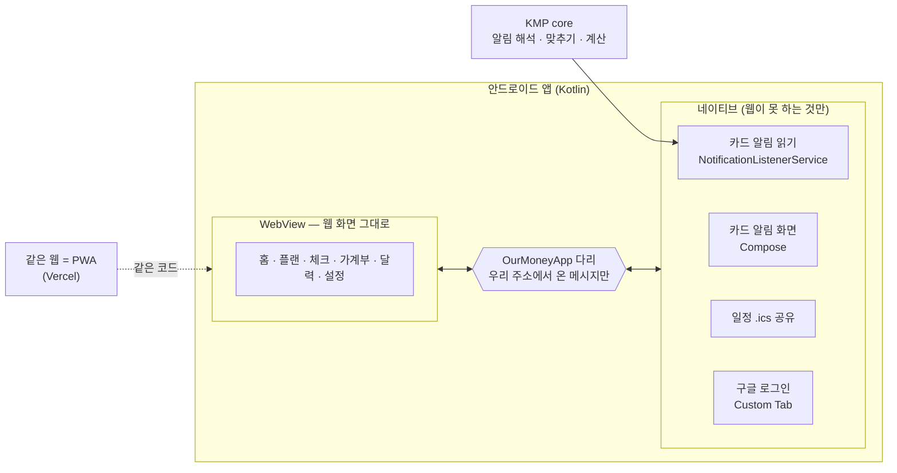
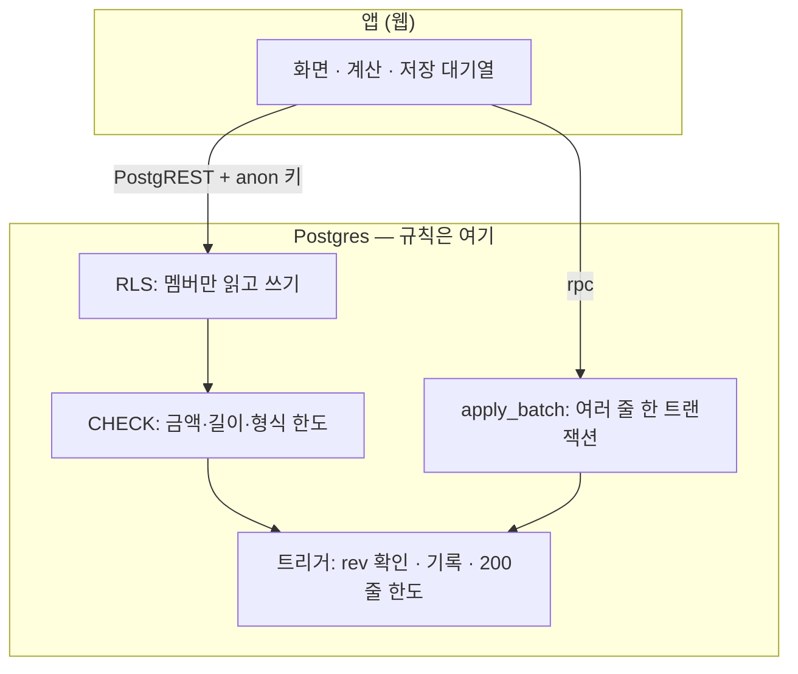
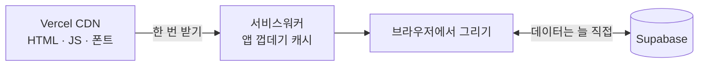
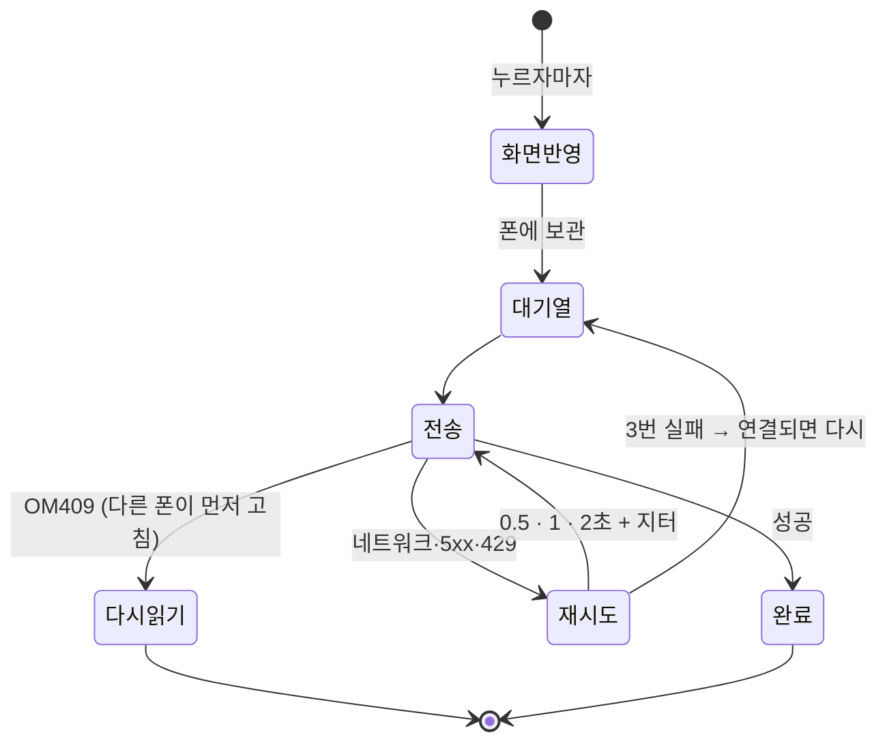
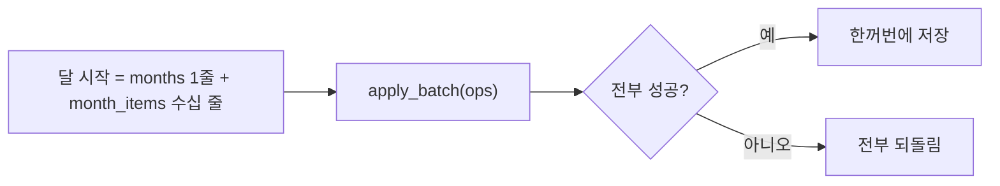
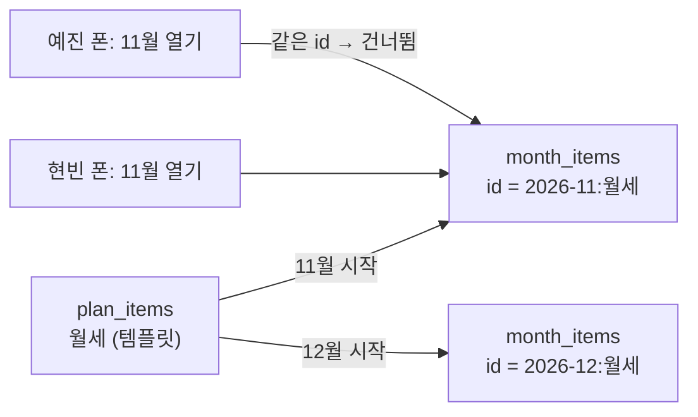
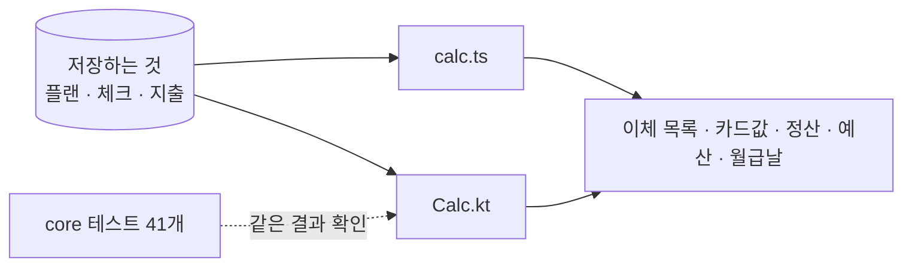
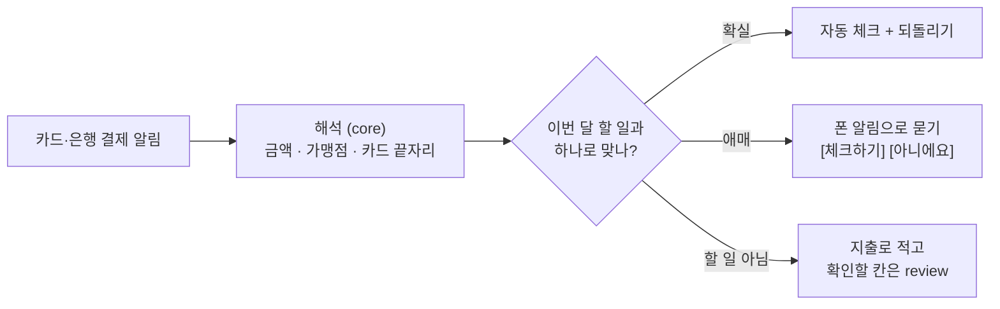
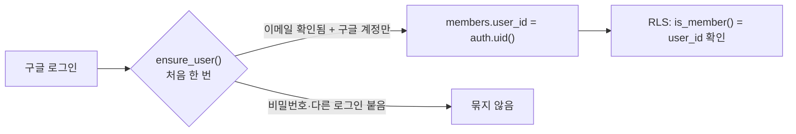
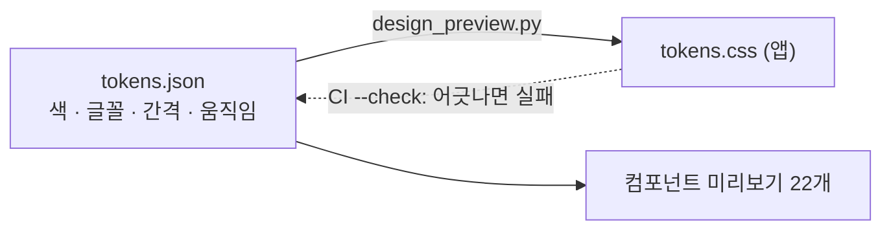

# 왜 이렇게 만들었나 — 설계 결정

[← README](../README.md) · [설계](ARCHITECTURE.md) · [사용 안내](GUIDE.md)

전제는 셋이에요. **사용자 두 명**, **혼자 만들고 고침**, **돈 정보라 틀리면 안 됨**. 모든 결정이 이 셋에서 나와요.

| # | 결정 | 한 줄 이유 |
|:-:|---|---|
| 1 | [안드로이드는 하이브리드 (WebView + 네이티브 조금)](#1-하이브리드-앱) | 화면은 한 번만 만들고, 웹이 못 하는 것(알림 읽기)만 네이티브 |
| 2 | [백엔드 서버 없이 Supabase](#2-백엔드-서버-없음) | 규칙을 DB 에 두면 지킬 서버가 없다 |
| 3 | [웹은 정적 export + PWA](#3-정적-웹--pwa) | 데이터는 전부 로그인 뒤라 서버 렌더링이 필요 없다 |
| 4 | [저장은 낙관적 + 대기열 + rev](#4-저장-낙관적--대기열--rev) | 폰은 끊기고, 두 사람은 동시에 고친다 |
| 5 | [여러 줄은 apply_batch 한 트랜잭션](#5-여러-줄은-한-트랜잭션) | 반쪽만 저장된 달이 남으면 안 된다 |
| 6 | [플랜은 템플릿 → 달마다 복사, id 를 정해 둠](#6-템플릿--달마다-복사) | 두 폰이 동시에 달을 열어도 한 번만 생긴다 |
| 7 | [계산은 클라이언트, 웹·Kotlin 같은 규칙](#7-계산은-클라이언트에서-두-언어로-같게) | 저장하지 않고 늘 다시 계산 — 끊겨도 바로 보인다 |
| 8 | [카드 알림은 폰에서 해석, 확실한 것만 자동](#8-카드-알림은-폰에서-애매하면-묻기) | 돈 기록을 기계가 멋대로 확정하지 않는다 |
| 9 | [멤버는 계정 id 에 묶음](#9-멤버는-계정에-묶기) | 이메일이 같다는 것만으로는 본인이 아니다 |
| 10 | [디자인은 토큰 한 파일에서](#10-디자인은-토큰-한-파일에서) | 색 하나 바꿀 때 한 곳만 고친다 |

---

## 1. 하이브리드 앱

| | 전부 Kotlin (Compose) | 전부 웹 (PWA) | **하이브리드 (고름)** |
|---|:---:|:---:|:---:|
| 화면 만들기 | 웹과 **두 번** | 한 번 | **한 번** |
| 카드 알림 읽기 | ✅ | ❌ 불가 | ✅ |
| 화면 고친 뒤 반영 | 앱 다시 배포 | 웹 배포만 | **웹 배포만** |
| 나중에 iOS | Compose MP 로 다시 | Safari PWA | 같은 웹 + iOS 껍데기 |

- **이유:** 8일 동안 PR 68개로 화면을 계속 바꿨어요. 화면이 두 벌이면 매번 두 번 고쳐야 해요. 웹이 **할 수 없는 것**(다른 앱의 결제 알림 읽기)만 네이티브로 만들었어요.
- **대가:** 첫 화면이 네이티브보다 조금 늦게 떠요. 다리는 정해 둔 메시지(알림 화면 열기 · `.ics` 공유 · 결제 알림 맞추기 `expect`/`matches`/`applied`)만 받고, 우리 웹 주소의 맨 위 화면에서 온 것만 받아요. 웹으로 넘기는 것도 알림 원문이 아니라 해석한 칸(금액 · 가맹점 · 카드 끝자리 · 할부)뿐이에요.
- **KMP 는 왜 남겼나:** 알림 해석·맞추기·계산은 웹 화면이 아니라 **백그라운드 서비스**에서 돌아야 해서 Kotlin 이 필요해요. `core` 에 두면 나중에 iOS 위젯·알림에도 그대로 써요.

## 2. 백엔드 서버 없음

- **이유:** 사용자 두 명에 서버를 따로 두면 지킬 것(배포·패치·비밀키)만 늘어요. Supabase 의 Postgres 에 **규칙을 DB 제약·트리거·RLS 로** 넣으면, 앱이 잘못 보내도 DB 가 막아요.
- **대가:** 로직이 SQL 로 가요. 그래서 마이그레이션마다 `schema.sql` 을 같이 고치게 CI 가 확인하고, SQL 은 PGlite 로 실제로 돌려 검증해요.

## 3. 정적 웹 + PWA

- **이유:** 모든 데이터가 로그인 뒤 두 사람만 보는 것이라 검색 노출·서버 렌더링이 필요 없어요. 정적 파일이면 서버 비용이 없고 어느 호스팅에도 올라가요.
- **대가:** 첫 로딩에 JS 를 받아야 해요. 서비스워커가 껍데기·폰트를 캐시하고, 데이터는 캐시하지 않아 두 폰이 늘 같은 내용을 봐요.

## 4. 저장: 낙관적 + 대기열 + rev

- **이유:** 지하철·엘리베이터에서도 기록이 바로 보여야 하고, 사라지면 안 돼요. 두 사람이 같은 항목을 고칠 수 있어서 **나중 저장이 앞 저장을 몰래 덮지 않게** 줄마다 `rev` 를 확인해요.
- **안전한 재전송:** 저장은 id 로 upsert 하고, 내용이 같으면 트리거가 rev 확인 전에 건너뛰어요. 그래서 같은 저장을 몇 번 보내도 결과가 같아요.

## 5. 여러 줄은 한 트랜잭션

- **이유:** REST 를 여러 번 부르면 중간에 끊겼을 때 "달은 있는데 항목이 반만" 같은 상태가 남아요.
- **다듬기(014):** 같은 칸 구성의 줄을 한 문장으로 써서 500줄 저장이 114ms → 20ms 가 됐어요. 문장마다 200줄로 나눠 대량 사고 방지 한도와 맞췄어요.

## 6. 템플릿 → 달마다 복사

- **이유:** 관리비처럼 달마다 조금 다른 금액은 그달만 고쳐야 해요. 그래서 템플릿을 달마다 복사해요. id 를 `달:템플릿` 으로 정해 두면 두 폰이 동시에 새 달을 열어도 `ignore_duplicates` 로 한 번만 생겨요.

## 7. 계산은 클라이언트에서, 두 언어로 같게

- **이유:** 이체 목록·카드값·정산은 **저장하지 않고** 늘 플랜과 기록에서 다시 계산해요(제품 원칙 "다시 적지 않고 계산"). 저장된 결과가 없으니 어긋날 일도 없어요.
- **대가:** 같은 규칙이 TypeScript·Kotlin 두 벌이에요. 규칙을 바꿀 때마다 두 곳을 같이 고치고 Kotlin 테스트를 더하는 것이 규칙이에요(예: 주말 월급날 → 앞 금요일).

## 8. 카드 알림은 폰에서, 애매하면 묻기

- **이유:** 알림 글은 카드사마다 다르고 틀릴 수 있어요. 알림 원문은 서버로 보내지 않고 폰에서 해석해, 해석한 칸만 웹으로 넘겨요. **확실한 것만 자동**으로 하고, 나머지는 사람에게 묻거나 `review` 칸에 남겨 가계부의 "확인 필요"로 보여요. 문자·메신저 앱 알림은 누구나 보낼 수 있어서 늘 물어요.

## 9. 멤버는 계정에 묶기

- **이유:** 토큰의 이메일만 보면, 남이 같은 이메일로 먼저 만든 계정도 멤버가 될 수 있어요. 처음 로그인할 때 **확인된 구글 계정만 계정 id 로 묶고**, 그 뒤로는 id 만 봐요. anon 키는 어떤 표에도 권한이 없어요.

## 10. 디자인은 토큰 한 파일에서

- **이유:** 색을 Pantone 2021 로 통째로 바꿀 때도 `tokens.json` 만 고치면 앱·미리보기·문서가 같이 바뀌었어요. 노랑처럼 대비가 낮은 색은 토큰 설명에 "채움에만"을 적어 두고 글자는 `accent-ink` 로 나눠요.
