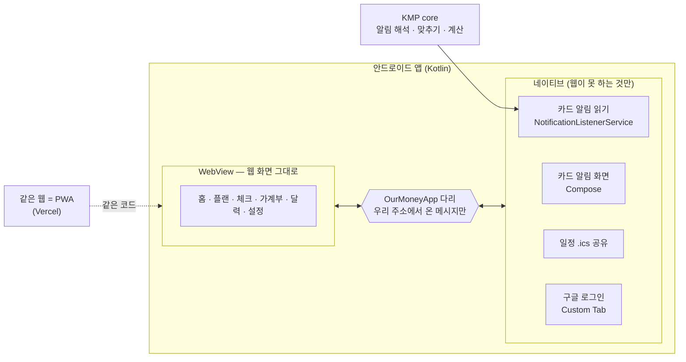
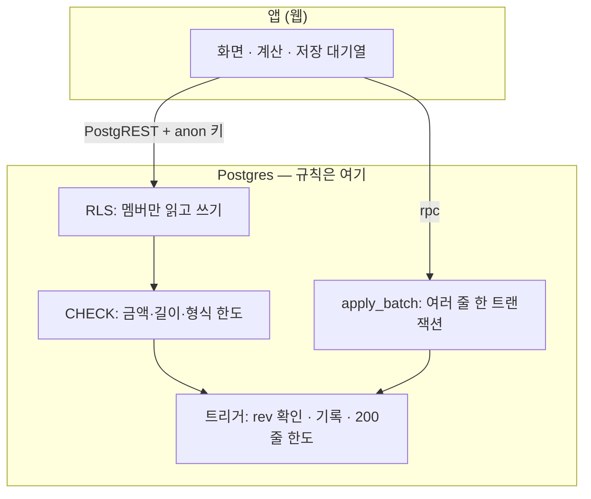
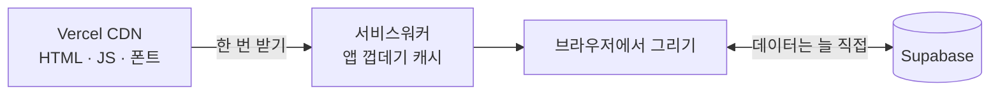
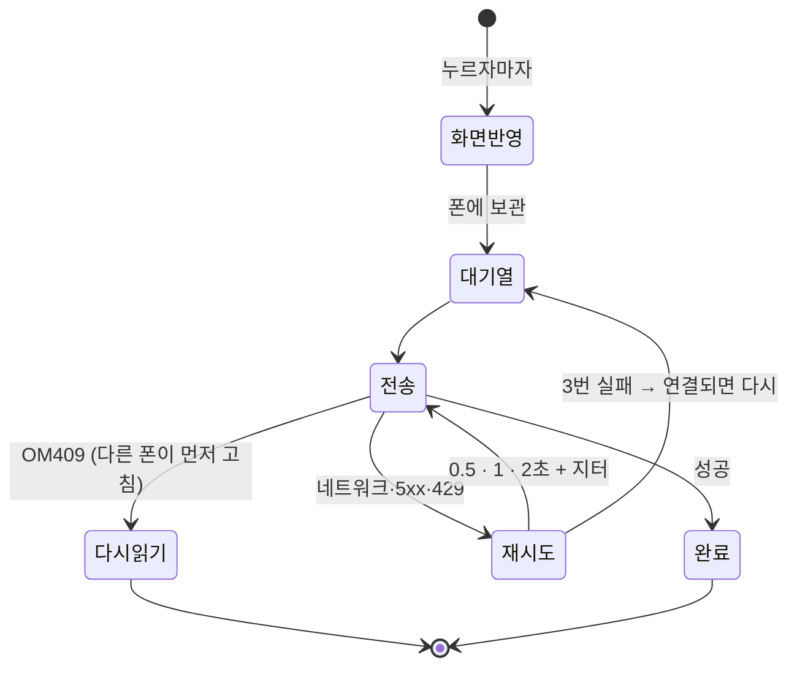
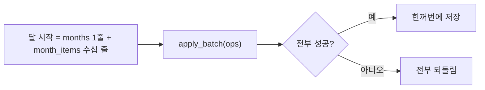
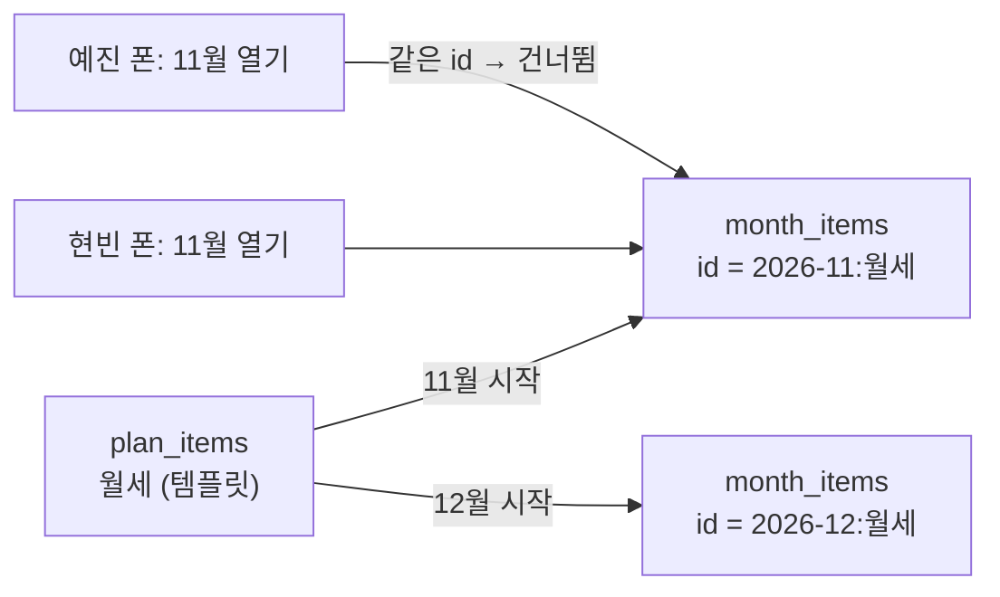
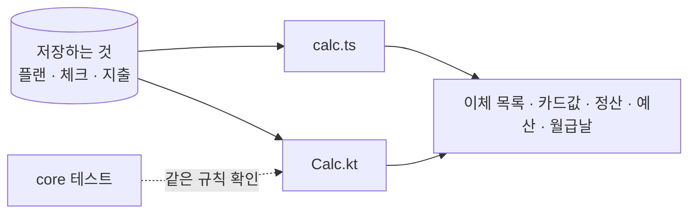
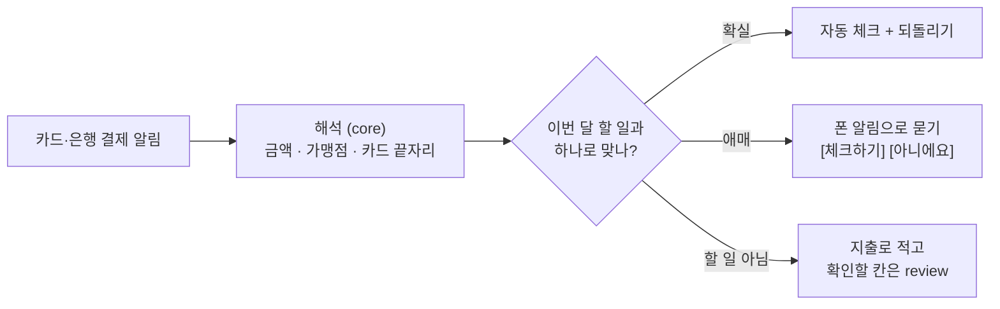
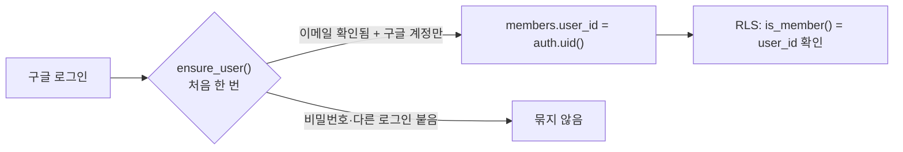
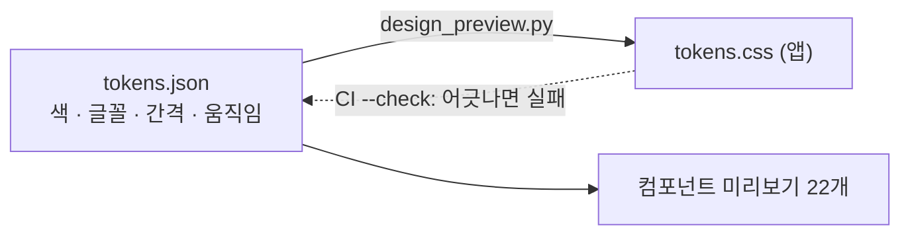

# 왜 이렇게 만들었나 — 2명 서비스의 트레이드오프

[← README](../README.md) · [설계](ARCHITECTURE.md) · [사용 안내](GUIDE.md)

**판단 기준**

| 기준 | 이 서비스에서는 |
|---|---|
| 만들고 고치는 비용 | 혼자 만들고, 8일 동안 PR 68개로 계속 바뀜 → **고치는 속도가 가장 비쌈** |
| 정확성 | 돈 정보 → 덮어쓰기·반쪽 저장·잘못된 자동 기록은 **0 이어야 함** |
| 규모 | 사용자 2명, 한 달 기록 수백 줄 → **확장성은 거의 값이 없음** |

결정마다 **선택지 · 얻는 것 · 잃는 것 · 2명 서비스 판단**을 같은 틀로 적고, 판단이 바뀌는 조건(**다시 볼 때**)을 남겼어요. ✅ 가 고른 것이에요.

| # | 결정 | 고른 것 | 결정적인 이유 |
|:-:|---|---|---|
| 1 | [앱 형태](#1-앱-형태) | 하이브리드 | 화면 한 벌 + 알림 읽기 |
| 2 | [백엔드](#2-백엔드) | 서버 없이 Supabase | 지킬 서버 0, 규칙은 DB 가 강제 |
| 3 | [웹 렌더링](#3-웹-렌더링) | 정적 export + PWA | 공개 페이지가 없음 |
| 4 | [저장과 동시 수정](#4-저장과-동시-수정) | 낙관적 + 대기열 + rev | 끊김·동시 수정이 실제로 일어남 |
| 5 | [여러 줄 저장](#5-여러-줄-저장) | apply_batch 한 트랜잭션 | 반쪽 저장 0 |
| 6 | [달마다의 플랜](#6-달마다의-플랜) | 템플릿 → 달마다 복사, id 고정 | 그달만 고치기 + 두 폰 동시 시작 |
| 7 | [계산 위치](#7-계산-위치) | 저장 없이 매번, 웹·Kotlin 두 벌 | 어긋날 저장값이 없음 |
| 8 | [카드 알림](#8-카드-알림) | 폰에서 해석, 애매하면 묻기 | 잘못된 자동 기록 0 |
| 9 | [멤버 확인](#9-멤버-확인) | 계정 id 에 묶기 | 같은 이메일 ≠ 본인 |
| 10 | [디자인 값](#10-디자인-값) | 토큰 한 파일 → 생성 | 한 곳만 고치기 |

---

## 1. 앱 형태

| 선택지 | 얻는 것 | 잃는 것 | 2명 서비스 판단 |
|---|---|---|---|
| 전부 웹 (PWA) | 가장 쌈, 배포 한 번 | **카드 알림을 읽을 수 없음** | ❌ 핵심 기능(알림으로 자동 체크)이 불가 |
| 전부 Kotlin (Compose) | 네이티브 속도·손맛, 오프라인 | 화면을 웹과 **두 벌**, 화면 고칠 때마다 앱 배포 | ⚠️ 품질은 좋지만 고치는 비용이 2배 |
| ✅ **하이브리드** | 화면 한 벌, **웹 배포로 앱 화면도 바뀜**, 알림 읽기 가능 | 첫 화면이 조금 느림, 웹↔앱 다리 관리 | ✅ 두 사람이 매일 쓰는 데 속도 차이는 작고, 고치는 속도가 훨씬 중요 |

- **대가를 줄인 방법:** 다리는 정해 둔 메시지(알림 화면 열기 · `.ics` 공유 · 결제 알림 맞추기 `expect`/`matches`/`applied`)만, 우리 웹 주소의 맨 위 화면에서 온 것만 받아요. 웹으로는 알림 원문이 아니라 해석한 칸(금액 · 가맹점 · 카드 끝자리 · 할부)만 넘겨요.
- **KMP core 를 남긴 이유:** 알림 해석·맞추기는 화면이 아니라 **백그라운드 서비스**에서 돌아야 해서 Kotlin 이 필요해요. `core` 에 두면 나중에 iOS 위젯·알림에도 그대로 써요.
- **다시 볼 때:** 무거운 오프라인 편집이나 프레임 단위 애니메이션이 핵심 기능이 될 때.

## 2. 백엔드

| 선택지 | 얻는 것 | 잃는 것 | 2명 서비스 판단 |
|---|---|---|---|
| 구글 시트 그대로 | 비용 0 | 폰에서 고치기 어려움, 동시 수정·검증 없음 | ❌ 앱을 만든 이유 그 자체 |
| 직접 API 서버 (+ DB) | 로직을 마음대로, 외부 연동·배치 자유 | 서버 배포·패치·비밀키·장애를 **혼자 지켜야 함** | ⚠️ 2명을 위해 운영할 것만 늘어남 |
| ✅ **Supabase (서버 없음)** | 지킬 서버 0, 로그인·실시간 기본, **규칙을 DB 가 강제** | 로직이 SQL 로, 외부 연동·정기 작업이 어려움, 벤더 의존 | ✅ 요청이 적어 무료 플랜 안, 외부 연동 없음 |

- **대가를 줄인 방법:** 마이그레이션마다 `schema.sql` 을 같이 고치게 CI 가 확인하고, SQL 은 PGlite 로 실제로 돌려 예전/새 함수를 비교해요. 데이터는 표준 Postgres 라 옮길 수 있어요.
- **다시 볼 때:** 은행 API 연동, 정기 배치, 푸시 서버처럼 "서버가 먼저 움직이는" 일이 필요할 때 (그땐 Edge Function 부터).

## 3. 웹 렌더링

| 선택지 | 얻는 것 | 잃는 것 | 2명 서비스 판단 |
|---|---|---|---|
| 서버 렌더링 (SSR) | 첫 화면 빠름, 검색 노출 | 서버 실행 비용, 로그인 정보를 서버에서도 다뤄야 함 | ⚠️ 보여 줄 공개 페이지가 없음 |
| ✅ **정적 export + PWA** | 호스팅 비용 0, CDN, 어디든 배포, 홈 화면 설치 | 첫 로딩에 JS, 검색 노출 없음 | ✅ 모든 데이터가 로그인 뒤 두 사람만 봄 |

- **대가를 줄인 방법:** 서비스워커가 껍데기·폰트를 캐시해 두 번째부터는 바로 떠요. 데이터는 캐시하지 않아 두 폰이 늘 같은 내용을 봐요.
- **다시 볼 때:** 공개 랜딩 페이지나 공유 링크가 생길 때.

## 4. 저장과 동시 수정

| 선택지 | 얻는 것 | 잃는 것 | 2명 서비스 판단 |
|---|---|---|---|
| 마지막 저장이 이김 | 가장 단순 | 상대가 고친 금액을 **몰래 덮어씀** | ❌ 돈이라 허용 불가 |
| 저장 끝까지 기다리기 | 단순, 서버와 늘 같음 | 누를 때마다 기다림, **끊기면 저장 실패** | ❌ 지하철·엘리베이터에서 기록이 사라짐 |
| ✅ **낙관적 + 대기열 + rev** | 바로 보임, 끊겨도 보관했다 보냄, 덮어쓰기 0 | 코드가 가장 복잡 (대기열 · rev 이어 맞추기 · 되돌리기) | ✅ 두 사람이 같은 체크·항목을 실제로 동시에 고침 |

- **대가를 줄인 방법:** 저장은 id 로 upsert 하고 내용이 같으면 트리거가 rev 확인 전에 건너뛰어서, 같은 저장을 몇 번 보내도 결과가 같아요(재전송이 안전).
- **다시 볼 때:** 사용자가 늘어도 같은 문제라 유지.

## 5. 여러 줄 저장

| 선택지 | 얻는 것 | 잃는 것 | 2명 서비스 판단 |
|---|---|---|---|
| REST 를 여러 번 | 함수 없이 단순 | 중간에 끊기면 **"달은 있는데 항목이 반만"** | ❌ 반쪽 상태를 사람이 찾아 고쳐야 함 |
| ✅ **apply_batch (한 트랜잭션)** | 전부 되거나 전부 안 됨 | DB 함수를 직접 관리 | ✅ 함수 하나로 모든 묶음 저장을 처리 |

- **다듬기(014):** 같은 칸 구성의 줄을 한 문장으로 써서 500줄 저장이 114ms → 20ms. 문장마다 200줄로 나눠 대량 사고 방지 한도와 맞췄어요.

## 6. 달마다의 플랜

| 선택지 | 얻는 것 | 잃는 것 | 2명 서비스 판단 |
|---|---|---|---|
| 항목 하나를 매달 같이 씀 | 저장 적음 | 관리비처럼 **그달만** 다른 금액을 못 적음 | ❌ 실제 고정비는 달마다 조금씩 다름 |
| 달마다 새 항목 (무작위 id) | 그달만 고치기 | 두 폰이 동시에 달을 열면 **항목이 두 벌** | ❌ 같이 쓰는 앱에서 실제로 일어남 |
| ✅ **템플릿 → 복사, id = `달:템플릿`** | 그달만 고치기 + 동시에 열어도 한 번 | 줄이 달마다 쌓임 | ✅ 한 달 수십 줄이라 쌓여도 작음 |

## 7. 계산 위치

| 선택지 | 얻는 것 | 잃는 것 | 2명 서비스 판단 |
|---|---|---|---|
| 결과(이체 목록 등)를 DB 에 저장 | 읽기만 하면 됨 | 플랜을 고칠 때마다 저장값도 고쳐야 함 — **어긋날 수 있음** | ❌ 틀린 이체 금액은 실제 송금 실수로 이어짐 |
| DB 함수로만 계산 | 한 벌 | 끊기면 계산도 못 봄, 화면이 서버를 기다림 | ⚠️ 오프라인 저장과 맞지 않음 |
| ✅ **저장 없이 매번, 웹·Kotlin 두 벌** | 어긋날 저장값 0, 끊겨도 즉시 | 같은 규칙이 두 언어 | ✅ 데이터가 작아 즉시 계산, 두 벌은 테스트로 맞춤 (주말 월급날 → 앞 금요일도 두 곳 + 테스트) |

- **다시 볼 때:** 기록이 수십만 줄이 되거나 서버가 먼저 계산해야 할 때(그땐 DB 함수로 옮김).

## 8. 카드 알림

| 선택지 | 얻는 것 | 잃는 것 | 2명 서비스 판단 |
|---|---|---|---|
| 손으로만 기록 | 틀릴 일 없음 | 매번 입력, 빠뜨림 | ⚠️ 원래 문제(번거로움) 그대로 |
| 알림을 모두 자동 확정 | 가장 편함 | 해석이 틀리면 **틀린 돈 기록**이 조용히 쌓임 | ❌ 정확성 기준 위반 |
| ✅ **폰에서 해석, 확실한 것만 자동** | 대부분 자동, 틀릴 만한 것만 사람에게 | 해석기·맞추기 규칙 관리 | ✅ 확인할 칸만 `review` 로 보여 주고, 문자·메신저처럼 누구나 보낼 수 있는 알림은 늘 물음 |

- 알림 원문은 서버로 보내지 않고 폰에서 해석해, 해석한 칸만 웹으로 넘겨요.

## 9. 멤버 확인

| 선택지 | 얻는 것 | 잃는 것 | 2명 서비스 판단 |
|---|---|---|---|
| 토큰의 이메일로 확인 | 단순 | 남이 **같은 이메일로 먼저 만든 계정**도 통과할 수 있음 | ❌ 공개 저장소 + 돈 정보 |
| ✅ **처음 한 번 계정 id 에 묶기** | 그 뒤로는 계정 id 만 봄 | 구글 계정을 바꾸면 SQL 로 다시 묶어야 함 | ✅ 사람이 2명이라 바꿀 일이 드물고, 바꿀 때 한 줄이면 됨 |

## 10. 디자인 값

| 선택지 | 얻는 것 | 잃는 것 | 2명 서비스 판단 |
|---|---|---|---|
| CSS 에 값을 바로 | 빠름 | 색 하나 바꿀 때 여러 파일 | ⚠️ 디자인을 자주 바꿈 |
| ✅ **토큰 한 파일 → 생성 + CI 확인** | 한 곳만 고치기, 미리보기·문서가 같이 바뀜 | 생성 스크립트 관리 | ✅ Pantone 색 전환을 토큰 수정 하나로 끝냄 |
