# 사용 안내 — 예시 데이터로 따라 해 보기

[← README](../README.md)

## 0. 예시 데이터 열기

```bash
cd apps/web && npm install && npm run dev   # http://localhost:3000
```

`.env.local` 이 없으면 **예시 데이터** 모드로 열려요(왼쪽 위 노란 알약). 고친 내용은 그 브라우저에만 남아요.
배포된 앱은 등록된 두 계정만 들어갈 수 있어요.

## 화면 지도

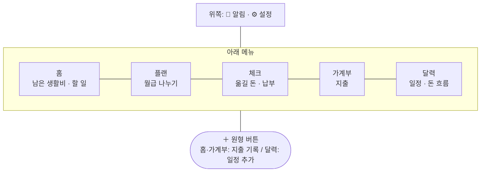

| 표시 | 뜻 |
|---|---|
| 🟡 노랑 채움 | 누를 곳 · 고른 탭 · 오늘 |
| 🟠 주황 · 🩷 분홍 · 🟡 노랑 | 현빈 · 예진 · 공동 (일정은 **입력한 사람** 색) |
| **−89,000원** · <span>**+3,800,000원**</span> | 나간 돈 · 들어올 돈(초록) |

---

## 1. 홈

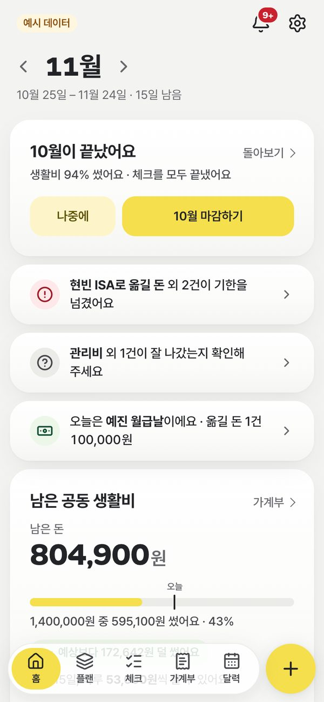 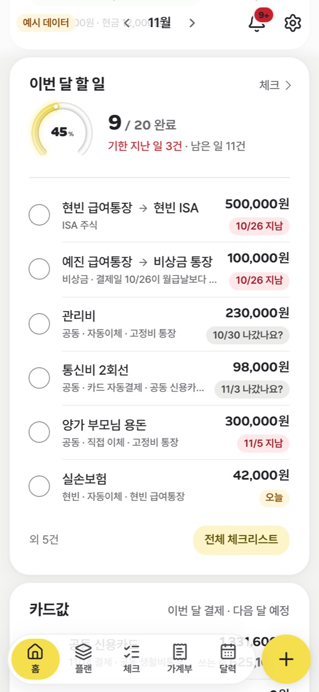

- [ ] 남은 돈 **804,900원** 아래 막대의 **오늘** 눈금: 오늘까지 써도 되는 선 → "예상보다 172,642원 덜 썼어요"
- [ ] **10월이 끝났어요 → 10월 마감하기**: 지난달 마감
- [ ] **이번 달 할 일**의 동그라미 누르기 → 완료, 줄이 끝낸 쪽으로 이동

## 2. 플랜 — 월급이 나뉘는 곳

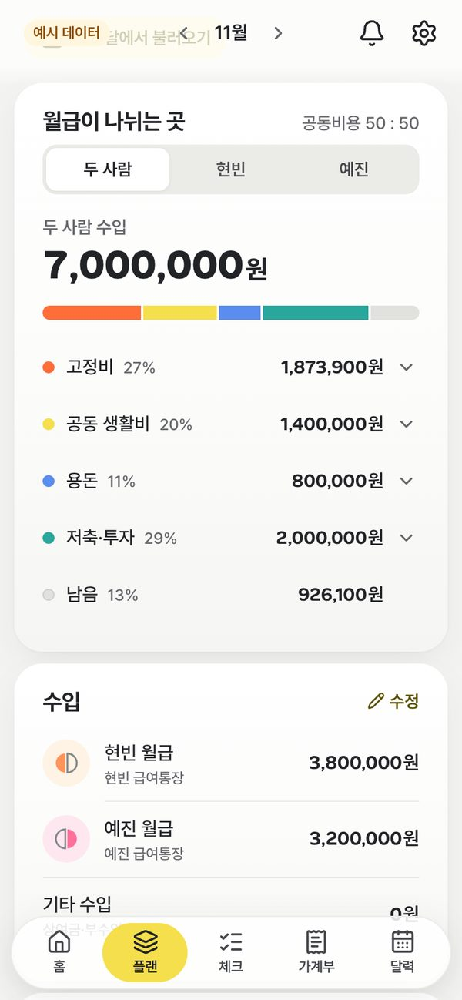 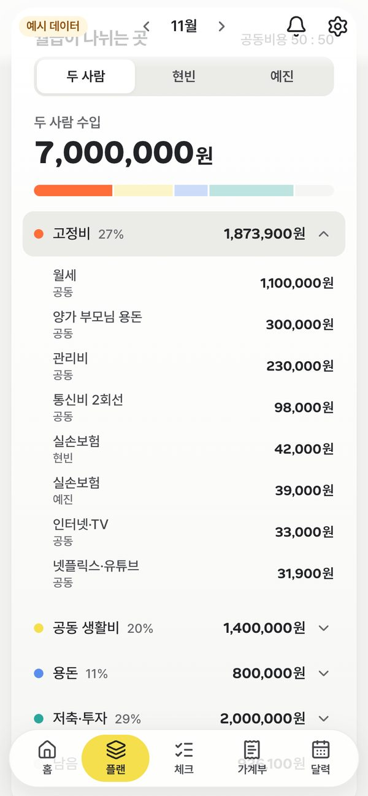 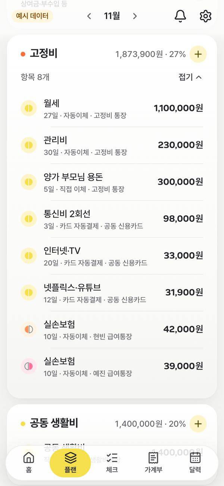

- [ ] 맨 위 **두 사람 수입**(큰 숫자)과 그 아래 한 줄 쌓은 막대 — 주황이 고정비, 노랑이 생활비…
- [ ] 아래 **고정비** 이름 누르기 → 막대에서 고정비 조각만 남고, 월세·관리비… 항목이 펼쳐짐
- [ ] 위 **현빈 / 예진** → 그 사람 월급 기준으로 다시 그림 (공동 항목은 비율만큼)
- [ ] 카드 제목 줄의 **＋** → 그 묶음에 항목 추가
- [ ] 폰에서 고정비·저축 카드의 **펼치기** → 접혀 있던 항목이 펼쳐짐 (세 줄 이상인 묶음만 접혀 있음)

## 3. 체크 — 옮길 돈 · 납부 · 카드값

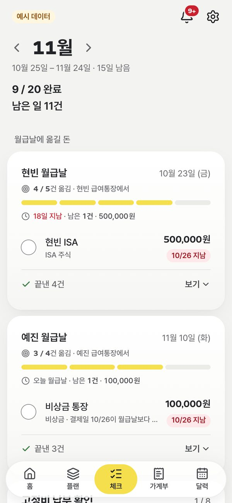

- [ ] **현빈 월급날** 카드: 급여통장 → 각 통장으로 옮길 돈. 동그라미로 체크, 진행 막대 칸이 채워짐
- [ ] 체크한 줄은 아래 **✓ 끝낸 N건 · 보기**로 접힘 → 눌러서 다시 보기
- [ ] 월급날이 주말이면 **앞 금요일**로 표시 (25일 일요일 → 23일)
- [ ] 아래 **고정비 납부 확인 · 카드값 준비 · 두 사람 정산 · 11월 마무리**

## 4. 가계부 — 지출

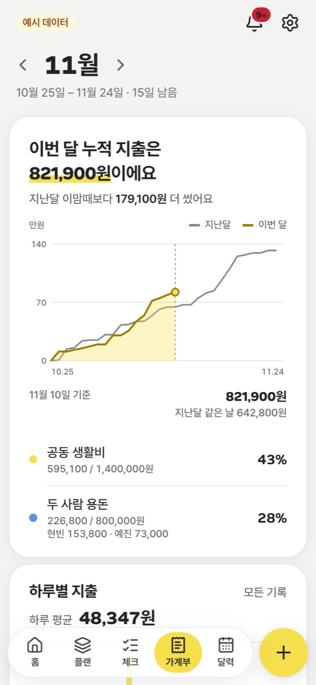 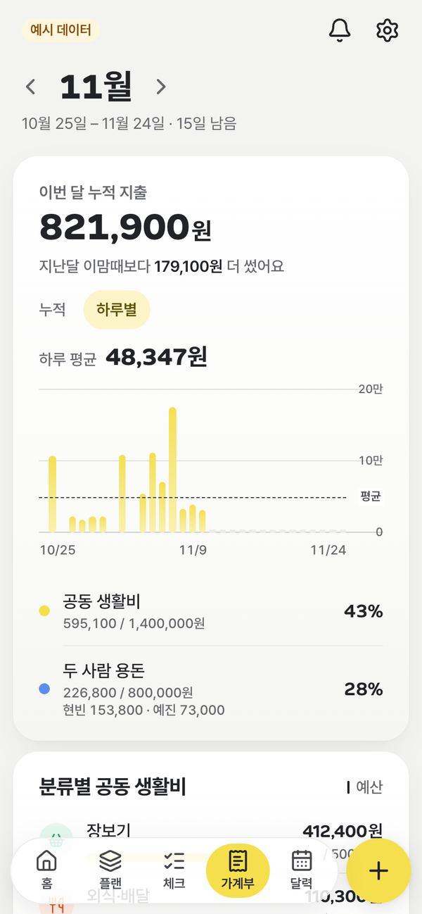 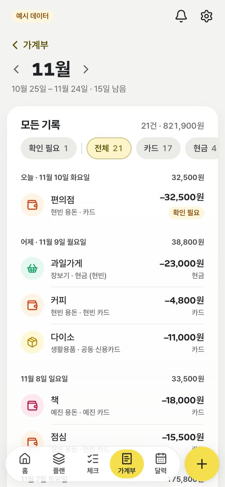 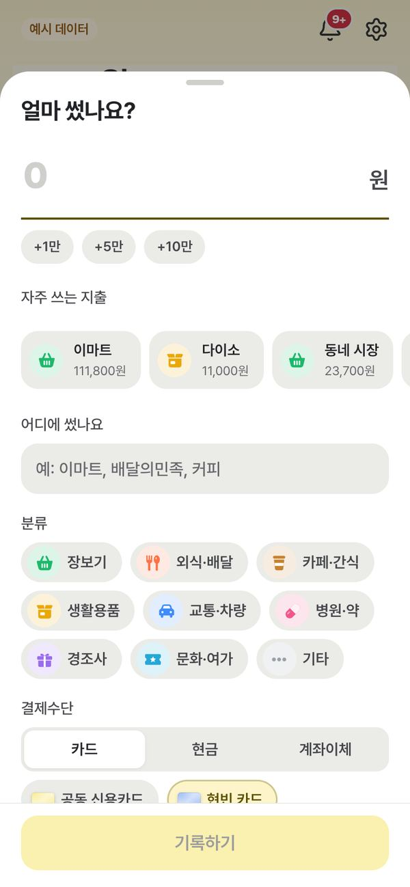

- [ ] 누적 그래프를 **누르고 끌기** → 그날 이번 달 · 지난달 누적
- [ ] 오른쪽 아래 **＋** → 금액 · 어디에 · 분류 · 결제수단 → **기록하기**
- [ ] **자주 쓰는 지출** 버튼 한 번으로 다시 넣기, 메모를 치면 분류가 따라옴
- [ ] 그래프 위 **누적 / 하루별** → 같은 카드에서 하루별 지출 막대로 바꿔 보기
- [ ] **최근 기록** 아래 **모든 기록 21건 보기** → 날짜별 전체 목록, 칩으로 카드/현금/이체 · 공동/현빈/예진 거르기, 왼쪽 위 **‹ 가계부**로 돌아오기

## 5. 달력 — 일정과 돈 흐름

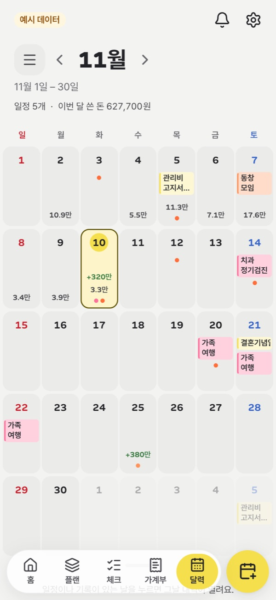 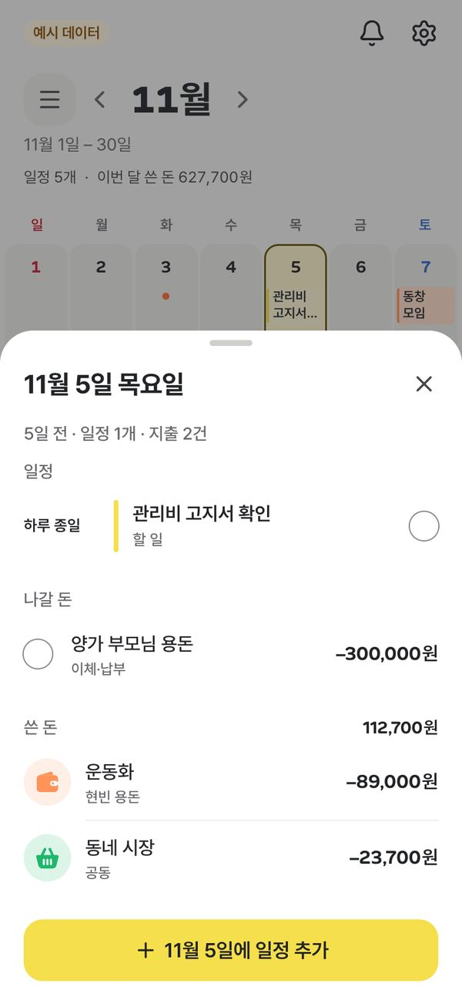 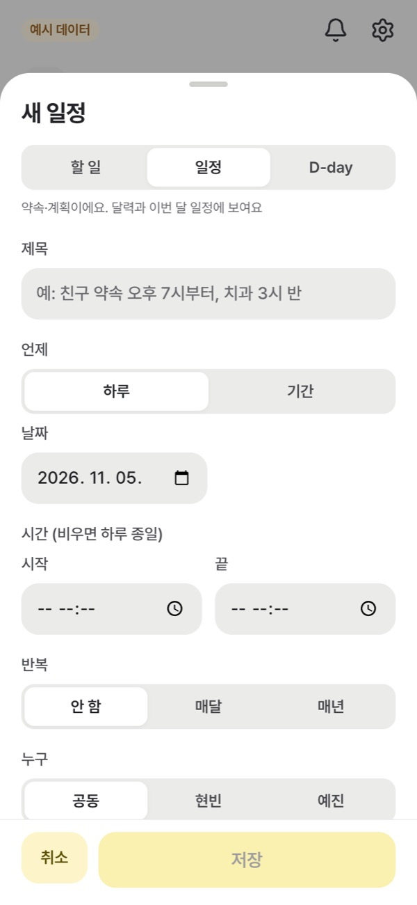

- [ ] 일정 칩 색 = **입력한 사람**, 초록 **+380만** = 월급날
- [ ] **5일** 누르기 → 일정 · 나갈 돈 · 쓴 돈(합계)이 묶인 패널
- [ ] 아무것도 없는 날 → 패널 없이 날짜만 고름, 아래 버튼이 **"N월 N일에 일정 추가"**
- [ ] 패널 맨 아래 **일정 추가** → 할 일 / 일정 / D-day

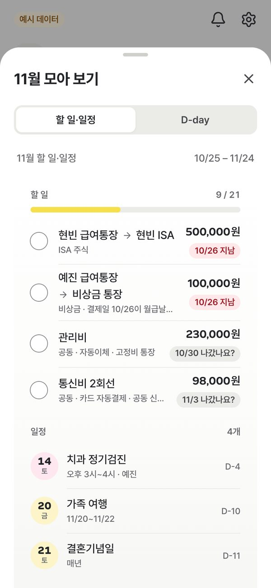

- [ ] 왼쪽 위 **☰** → 이번 달 할 일 · D-day 모아 보기
- [ ] 아래로 **손잡이를 밀어 올리기** → 한 주로 접기, 좌우로 밀어 주 넘기기

## 6. 알림 — 지난주 돌아보기

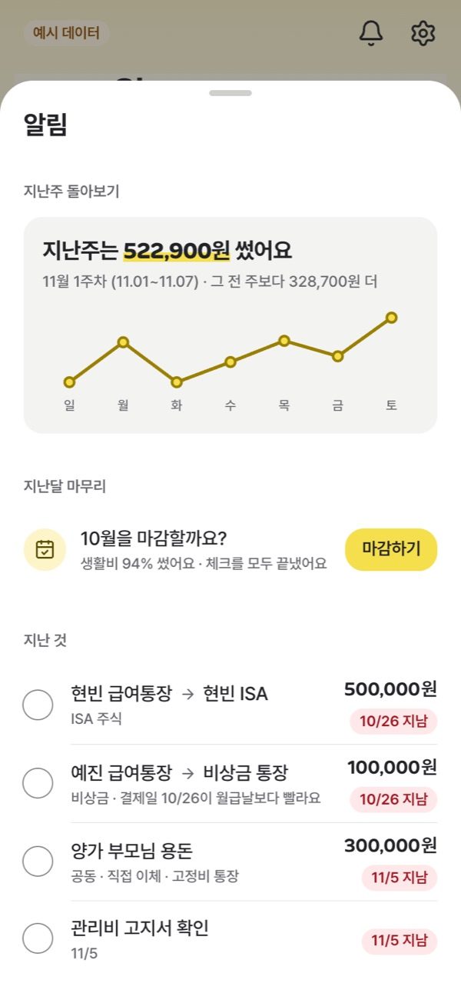 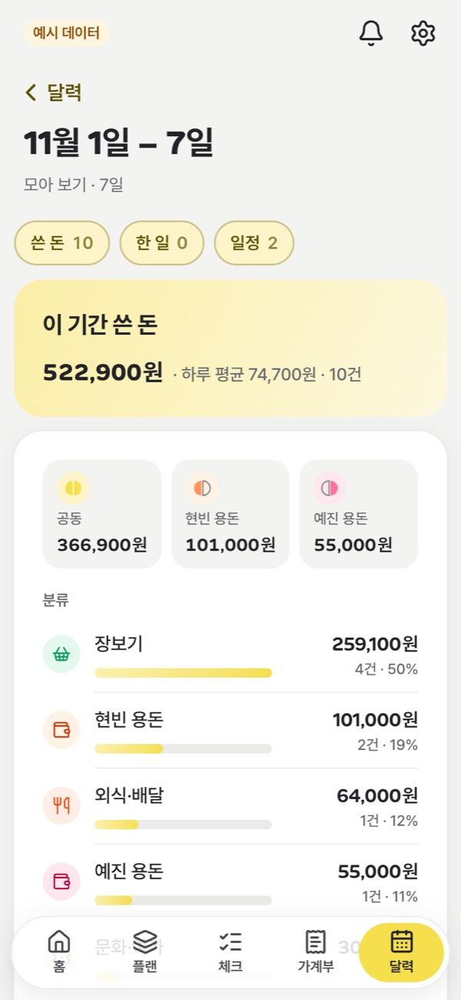

- [ ] 🔔 → 일·월·화요일엔 맨 위에 **"지난주 쓴 돈 522,900원"** + 요일별 선
- [ ] 카드 누르기 → 그 주 **모아 보기**(공동/현빈/예진, 분류별)
- [ ] 지난 것 · 잘 나갔나요? · 다가오는 날(월급날 · D-day)

## 7. 설정 — 지갑

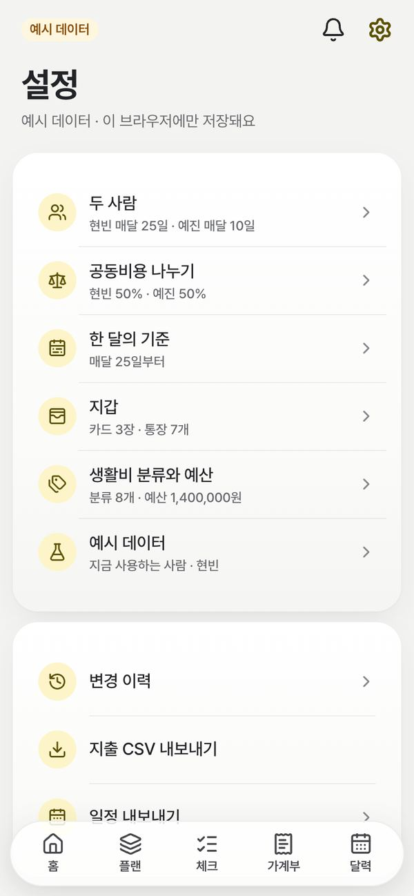 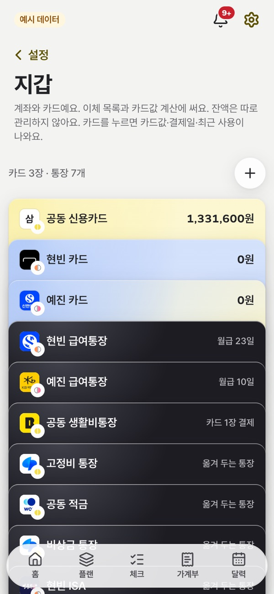 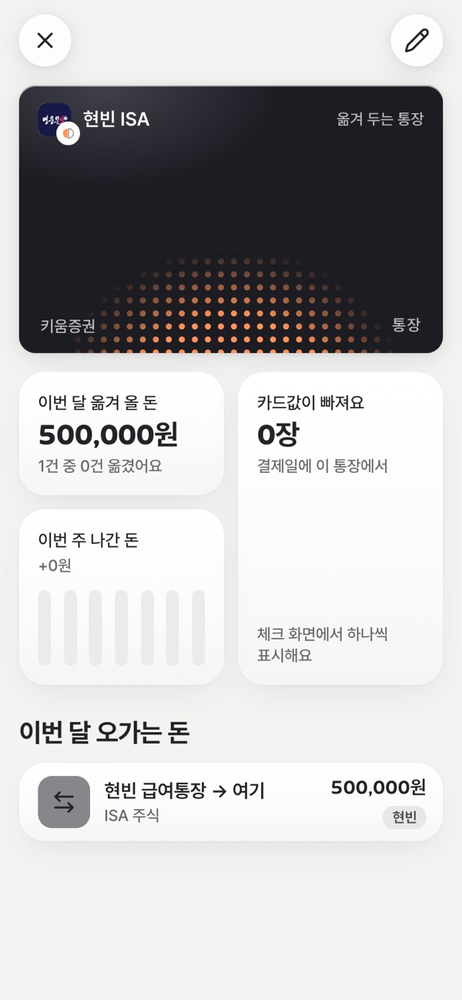

- [ ] 카드·통장이 실물처럼 겹친 **지갑**, 누르면 이번 달 카드값 · 옮겨 올 돈 · 최근 사용
- [ ] 폰에서는 묶음 목록(두 사람 · 공동비용 나누기 · 한 달의 기준 · 지갑 · 분류와 예산 · 화면 · 예시 데이터)에서 하나를 눌러 그 묶음만 고치고, **‹ 설정**으로 돌아오기. 데스크톱은 모든 묶음이 한 화면에
- [ ] 목록 아래 **변경 이력 · 지출 CSV 내보내기 · 일정 내보내기**
- [ ] 안드로이드 앱에서는 **폰 알림** → 알림 켜기 (일정 미리 알림 · 월급날 · 내일 나갈 돈)
- [ ] **화면** → 밝게 · 어둡게 · 기기 설정. 어둡게를 누르면 바로 바뀌고, 다시 열어도 이 브라우저에선 그대로

## 데스크톱

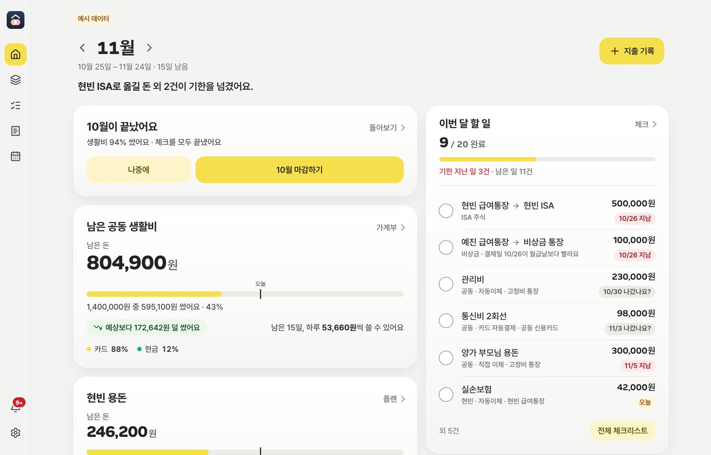 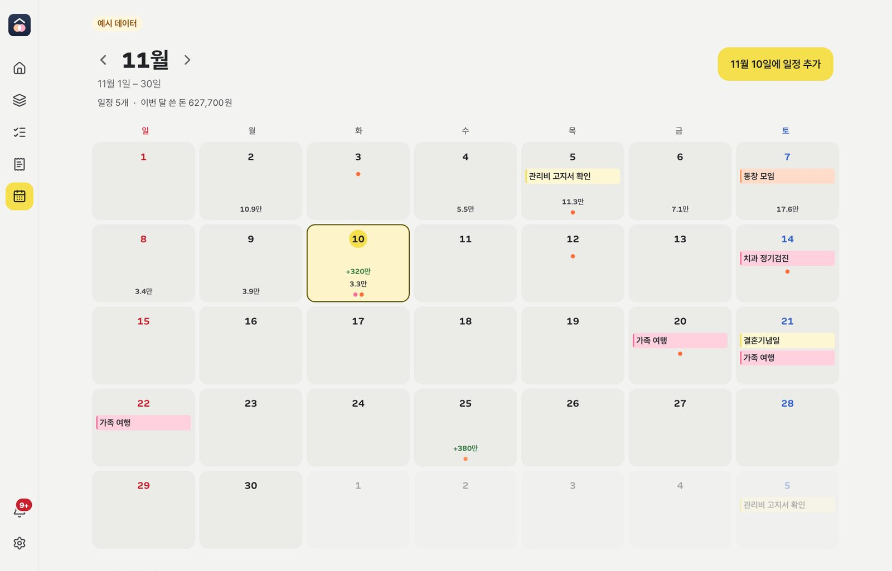

넓은 화면에서는 왼쪽 레일 + 두 열 배치로 바뀌어요.
